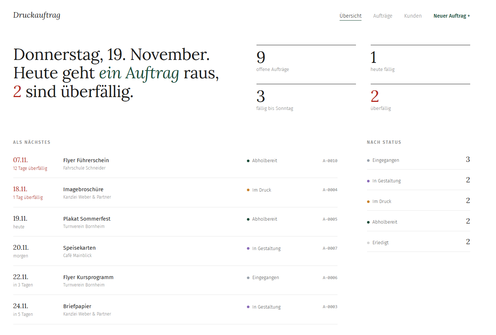
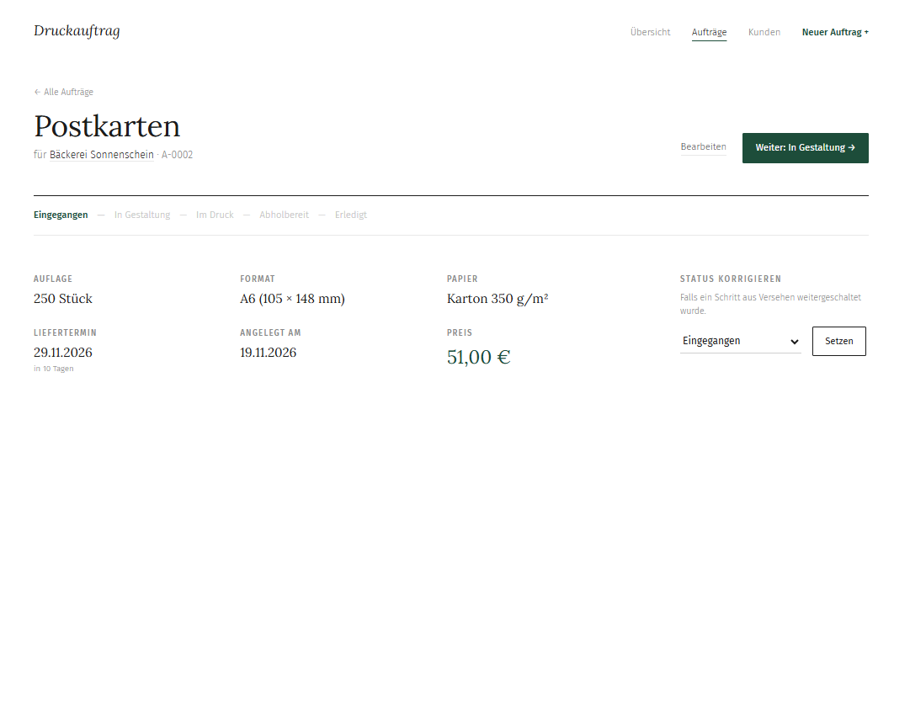
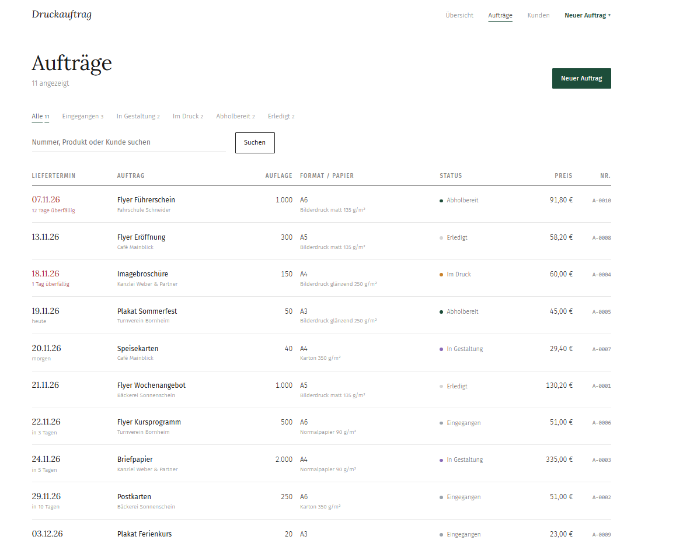
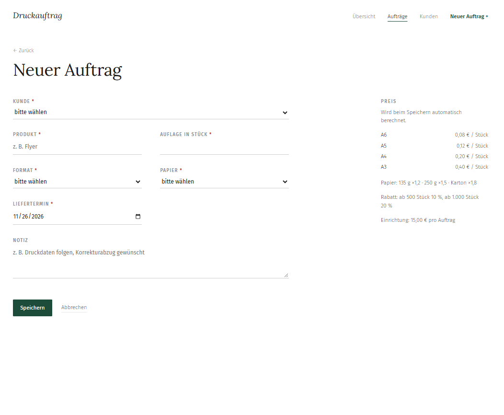
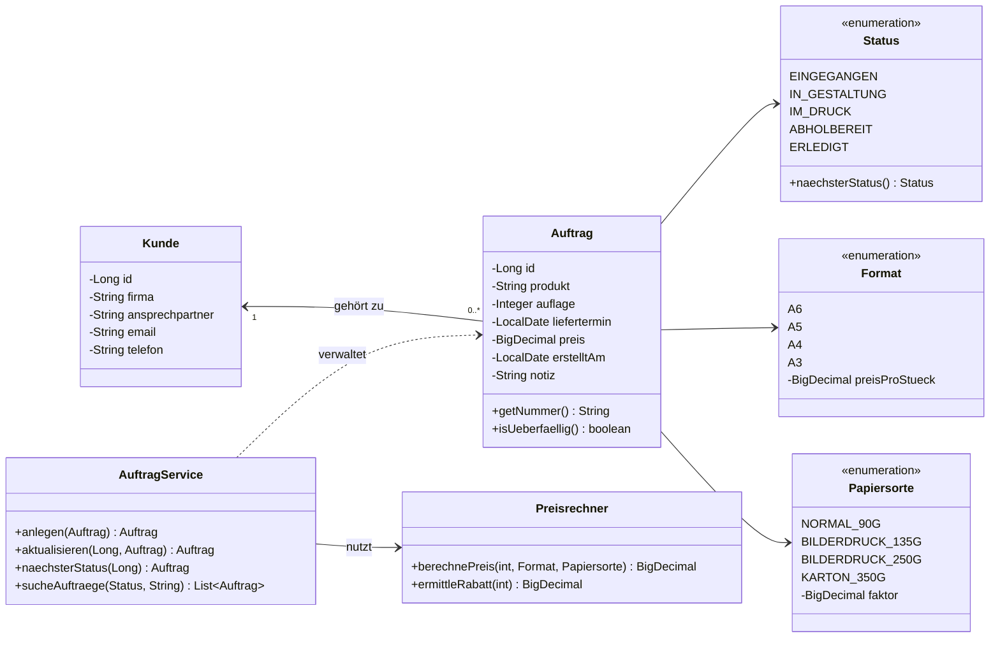

# Druckauftrag-Manager

Eine Auftragsverwaltung für eine kleine Digitaldruckerei, gebaut mit Java und Spring Boot.

Vor meiner Umschulung habe ich in der Projektabwicklung einer Digitaldruckerei gearbeitet. Dort habe ich gesehen, wie viel Zeit es kostet, Aufträge, Liefertermine und Kundendaten in Tabellen und E-Mails im Blick zu behalten. Dieses Projekt bildet den typischen Ablauf vom Auftragseingang bis zur Abholung in einer einfachen Webanwendung ab.

## Funktionen

- **Kunden** anlegen, bearbeiten, anzeigen und suchen
- **Druckaufträge** anlegen und bearbeiten: Produkt, Auflage, Format, Papiersorte, Liefertermin, Notiz
- **Statusablauf** mit einem Klick weiterschalten:
  `Eingegangen → In Gestaltung → Im Druck → Abholbereit → Erledigt`
  (bei Bedarf auch direkt korrigierbar)
- **Automatische Preisberechnung** nach Auflage, Format und Papiersorte, mit Mengenrabatt
- **Übersicht (Dashboard)** mit Kennzahlen (offen, heute fällig, diese Woche fällig, überfällig) und einer Liste der bald fälligen Aufträge
- **Suche und Filter** der Aufträge nach Status, Auftragsnummer, Produkt oder Kunde
- Überfällige Aufträge werden rot hervorgehoben
- Responsives Layout, funktioniert auch auf dem Tablet

## Design

Die Oberfläche ist bewusst schlicht und typografisch gehalten: viel Weißraum, feine Linien statt Kästen und nur eine Akzentfarbe (Dunkelgrün). Für Überschriften und Zahlen wird die Serifenschrift *Lora* verwendet, für den Text *Fira Sans*. Die Startseite fasst den Tag in einem Satz zusammen, z. B. „Heute geht ein Auftrag raus, einer ist überfällig.“

Die Schriften liegen direkt im Projekt (`static/fonts`) und werden nicht von Google Fonts geladen. So funktioniert die Anwendung auch ohne Internet, und es werden keine Daten an Dritte übertragen.

## Screenshots

<!-- Screenshots im Ordner docs/screenshots ablegen -->

| Übersicht | Auftrag |
|-----------|---------|
|  |  |

| Auftragsliste | Neuer Auftrag |
|---------------|---------------|
|  |  |

## Verwendete Technik

| Bereich | Technik |
|---------|---------|
| Sprache | Java 21 |
| Build | Maven |
| Framework | Spring Boot 4 (Spring MVC) |
| Oberfläche | Thymeleaf (serverseitig gerendert), eigenes CSS ohne Framework |
| Schriften | Lora und Fira Sans, lokal eingebunden (SIL Open Font License) |
| Datenbank | H2 als Datei-Datenbank, Zugriff mit Spring Data JPA |
| Validierung | Jakarta Bean Validation (`@NotBlank`, `@Min`, `@Email` …) |
| Tests | JUnit 5 |

## Installation und Start

**Voraussetzungen:** Java 21 und Maven 3.9 oder neuer

```bash
git clone https://github.com/Ario-Mi/druckauftrag-manager.git
cd druckauftrag-manager
mvn spring-boot:run
```

Danach im Browser öffnen: <http://localhost:8080>

Beim ersten Start werden automatisch einige Beispielkunden und -aufträge angelegt. Die Daten werden im Ordner `data/` gespeichert und bleiben nach einem Neustart erhalten. Wer wieder mit den Beispieldaten starten möchte, löscht einfach den Ordner `data/`.

**Tests ausführen:**

```bash
mvn test
```

## Projektstruktur

```
src/main/java/de/ario/druckauftrag/
├── model/         Kunde, Auftrag und die Enums Status, Format, Papiersorte
├── repository/    Datenbankzugriff mit Spring Data JPA
├── service/       Geschäftslogik, Preisrechner, Beispieldaten
└── controller/    Verarbeitet die Anfragen aus dem Browser

src/main/resources/
├── templates/     Thymeleaf-Seiten (Übersicht, Kunden, Aufträge)
├── static/css/    Stylesheet
└── static/fonts/  Schriftdateien mit Lizenz
```

## Preisberechnung

```
Preis = Grundpreis (Format) × Faktor (Papiersorte) × Auflage − Mengenrabatt + 15 € Einrichtung
```

| Format | Grundpreis / Stück |  | Papiersorte | Faktor |
|--------|-------------------:|--|-------------|-------:|
| A6 | 0,08 € | | Normalpapier 90 g | 1,0 |
| A5 | 0,12 € | | Bilderdruck matt 135 g | 1,2 |
| A4 | 0,20 € | | Bilderdruck glänzend 250 g | 1,5 |
| A3 | 0,40 € | | Karton 350 g | 1,8 |

Mengenrabatt: ab 500 Stück 10 %, ab 1.000 Stück 20 %.

Beispiel: 500 Flyer A4 auf Bilderdruck 135 g → 500 × 0,20 € × 1,2 = 120,00 € − 10 % = 108,00 € + 15,00 € = **123,00 €**

Die Preise sind vereinfachte Beispielwerte.

## UML-Klassendiagramm



## Was ich dabei gelernt habe

- **Schichtenaufbau einer Webanwendung:** Controller, Service und Repository haben jeweils eine klare Aufgabe. Dadurch bleibt der Code übersichtlich, und die Geschäftslogik (z. B. die Preisberechnung) lässt sich unabhängig von der Oberfläche testen.
- **JPA und Datenbanken:** Wie aus Java-Klassen Tabellen werden, wie eine Beziehung zwischen Auftrag und Kunde (`@ManyToOne`) aussieht und wie Spring Data aus Methodennamen fertige Abfragen erzeugt.
- **Rechnen mit Geldbeträgen:** Warum man für Preise `BigDecimal` statt `double` verwendet und wie kaufmännisch gerundet wird.
- **Formulare und Validierung:** Eingaben mit Annotationen prüfen und verständliche Fehlermeldungen direkt am Feld anzeigen.
- **Thymeleaf:** Seiten serverseitig erzeugen und wiederkehrende Teile wie die Navigation als Fragmente nur einmal schreiben.
- **Eigenes CSS:** Ein einheitliches Layout mit CSS-Variablen, Flexbox und Grid, das sich auch an kleinere Bildschirme anpasst. Schriften habe ich mit `@font-face` selbst eingebunden, statt sie von einem externen Dienst zu laden.
- **Unit-Tests mit JUnit 5:** Die Preisberechnung ist mit Tests abgesichert, auch für Grenzfälle wie genau 500 Stück.
- **Fachwissen umsetzen:** Den Ablauf, den ich aus der Druckerei kenne, in Datenmodell und Statuslogik zu übersetzen.

## Mögliche Erweiterungen

- Anmeldung mit Benutzerrollen (z. B. mit Spring Security)
- PDF-Auftragsbestätigung für Kunden
- Preise und Papiersorten über die Oberfläche pflegen statt im Code
- Umstieg auf eine Datenbank wie PostgreSQL oder MariaDB
